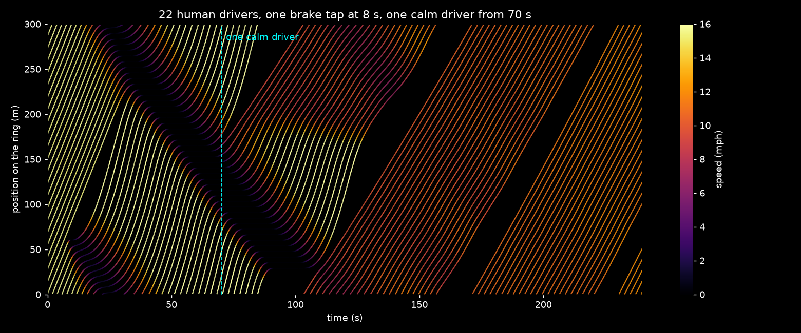

# 009: One Car Fixed a Traffic Jam

22 cars drive around a 300 m ring road. No lights, no merges, no accidents. At 8 s one driver taps the brakes once, and the ring falls into stop-and-go traffic that never clears by itself: a **phantom traffic jam**.

At 70 s, one car is swapped for a calm driver who holds its own average speed and keeps a gap instead of braking hard. The jam dissolves.

Based on the real experiment by Sugiyama et al. (2008, *New Journal of Physics*), where 22 drivers on a circular track in Japan formed a jam out of nothing, and the 2018 follow-up by Stern et al., where one automated car smoothed the waves out.

## How it works

- Every human driver follows the **Intelligent Driver Model (IDM)**: speed up toward a desired speed, brake when the gap to the car ahead shrinks, plus a little random wobble, because nobody drives perfectly smoothly.
- Each driver brakes a little harder than the car in front, so a small slowdown grows as it travels backwards through the line. On a ring it never dies out.
- The calm driver (car 11) tracks a 30 s running average of its own speed (allowed to creep 0.3 m/s above it when there is room) and never closes the gap fast. It absorbs the waves instead of passing them on.

## Results (seed 7)

| | Human drivers only (last 60 s) | One calm driver (last 60 s) |
|---|---|---|
| Full stops per car per minute | 1.50 | 0.00 |
| Time spent stopped | 34.5% | 0.0% |
| Average speed | 9.2 mph | 11.3 mph (+23%) |

The jam is gone 35 s after the swap.



Each line is one car (time across, position on the ring up). Dark bands leaning backwards are the jam wave. After the dashed line they fade out. The empty diagonal stripes after the swap are the gap the calm driver keeps in front of it (about 68 m). That is how it soaks up the waves, though on a real road other drivers would cut into a gap that big.

## Run it

```bash
pip install -r requirements.txt
python3 traffic.py   # prints the table above, writes sim.json
python3 plot.py      # writes spacetime.png
```

Things to try: change `BIAS` (too eager and the jam comes back), `SWAP`, the number of cars `N`, or the brake tap in `run()`.
